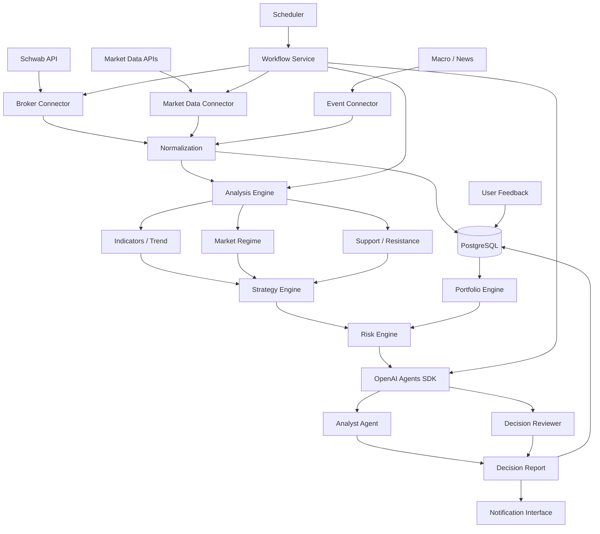
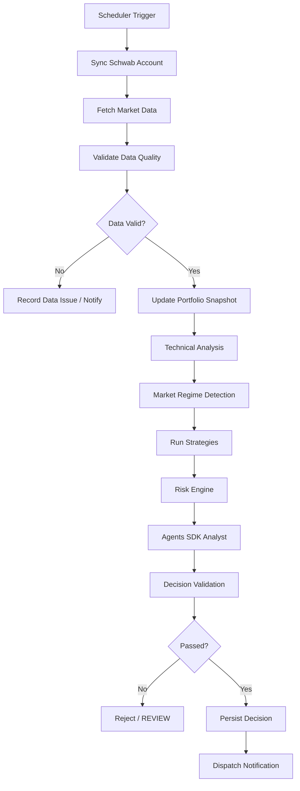

# Personal Trading Agent — POC 施工文档

**版本：** V1.0  
**范围：** 美股股票与 ETF  
**券商：** Charles Schwab  
**自主等级：** L2（自动分析、建议、提醒；人工执行）  
**Agent：** OpenAI Agents SDK  
**模型：** 自建 OpenAI-compatible LLM  
**部署：** 独立服务器 / Docker Compose  
**通知：** 定时通知 + 事件驱动通知；渠道 TBD

## 1. 项目目标

建设一个以个人投资组合为中心的美股交易情报与决策辅助系统。系统自动同步 Schwab 账户信息、获取市场行情、计算技术指标、运行多策略、执行组合风险检查，再通过 OpenAI Agents SDK 综合结构化结果，形成可解释、可追溯的行动建议。

核心闭环：

1. 同步账户、持仓、未完成订单和成交记录。
2. 获取美股、ETF、指数行情及历史 K 线。
3. 计算多周期技术指标、趋势、支撑阻力和市场状态。
4. 运行多个独立策略，生成结构化信号。
5. 使用确定性 Risk Engine 校验候选动作。
6. Agent 综合市场、策略、持仓和风险结果，形成建议。
7. 发送定时报告和事件触发预警。
8. 记录建议、用户反馈、实际成交及后续表现，支持复盘。

### 1.1 POC 验收标准

| 维度 | 验收要求 |
|---|---|
| 行情质量 | 每条行情有来源、时间戳、交易时段、延迟标记 |
| 持仓准确性 | 本地快照可与 Schwab 账户核对 |
| 技术计算 | 指标由确定性程序计算，具备单元测试 |
| 策略透明 | 信号包含触发条件、失效条件和策略版本 |
| 风险约束 | 所有建议经过独立 Risk Engine |
| Agent 可控 | 只调用白名单工具，不具备下单能力 |
| 通知 | 定时与事件驱动两种模式均可运行 |
| 可审计 | 可重建建议生成时的数据、配置和策略状态 |

### 1.2 POC 不做

- 自动提交、取消或修改 Schwab 订单。
- 自动修改止损单或风险预算。
- 期权、期货、杠杆 ETF、融券卖空策略。
- 高频交易或自动化交易执行。
- LLM 自主修改策略规则。
- 未经回测和前瞻性验证的自动参数优化。

## 2. 已确认需求与待补充信息

### 2.1 已确认配置

| 配置项 | 选择 | 设计约束 |
|---|---|---|
| Trading Style | Multi | 多策略并行评估 |
| Market | US | 美股股票与 ETF |
| Autonomy | L2 | 自动分析、建议、提醒；人工执行 |
| Broker | Schwab | 账户与交易数据入口 |
| Notification | Both | 定时 + 事件触发 |
| Deployment | Server | 独立服务器常驻运行 |
| Push Channel | TBD | 先抽象接口，不绑定平台 |
| Agent Framework | OpenAI Agents SDK | Agent 编排与工具调用 |
| LLM | Self-hosted | 通过模型适配层接入 |

### 2.2 POC 启动前需要补齐

以下信息不得由开发 Agent 猜测：

1. Schwab Developer Portal 应用状态、API 权限及账户授权情况。
2. 账户数量、账户类型及可访问权限。
3. 完整持仓、现金余额、成本基础及币种。
4. QQQ 实际成本基础。
5. 单笔风险预算、单标的最大仓位、组合最大回撤阈值。
6. 盘前/盘后行情是否可作为正式信号触发依据。
7. 自建 LLM 的 Base URL、模型 ID、鉴权方式、Tool Calling 兼容性。
8. 服务器操作系统、资源规格和网络条件。
9. 最终通知渠道及接收对象。
10. 首期观察名单和扫描标的数量。

### 2.3 初始测试持仓

| 标的 | 数量 | 成本 |
|---|---:|---:|
| GOOG | 10 | USD 289.60 |
| QQQ | 20 | 待确认 |

上述数据仅作为测试夹具。正式运行前必须由 Schwab 或用户确认的数据覆盖。此前提及的股票与现金约 1.4:1 也必须重新核实。

## 3. 总体架构

### 3.1 模块职责

- **Data Connectors：** 连接 Schwab、行情、宏观和新闻数据源。
- **Normalization：** 统一标的、时间、币种、交易时段和数据质量状态。
- **Portfolio Engine：** 维护持仓快照、现金、权重、订单和成交状态。
- **Analysis Engine：** 计算技术指标、趋势、支撑阻力和市场状态。
- **Strategy Engine：** 运行确定性策略，生成候选信号。
- **Risk Engine：** 执行硬性风险约束，拥有最终否决权。
- **OpenAI Agents SDK：** 组织分析、解释、复核和报告生成。
- **Scheduler：** 定时任务和事件轮询。
- **Notification Service：** 统一消息发送接口。
- **PostgreSQL：** 保存账户快照、行情、信号、决策和审计记录。

### 3.2 逻辑架构



### 3.3 强制架构约束

1. LLM 不直接访问券商下单接口。
2. Agent 不自行计算或臆测技术指标。
3. Risk Engine 不依赖 LLM 判断。
4. 每条建议必须引用行情快照、持仓快照和策略版本。
5. 数据缺失、过期或异常时输出 `NO_ACTION`，并标记 `DATA_INVALID` 或 `DATA_STALE`。
6. 数据库统一以 UTC 存储时间，同时保留交易所时区 `America/New_York`。
7. 交易日历、夏令时和半日市由交易日历组件处理，禁止硬编码固定 UTC 开盘时间。
8. POC 只开放只读券商权限，不实现下单写接口。

## 4. 技术选型

| 层级 | 技术 | 用途 |
|---|---|---|
| Runtime | Python 3.12+ | 核心服务 |
| API | FastAPI | 管理 API、健康检查 |
| Agent | OpenAI Agents SDK | Agent、工具调用、Guardrails |
| LLM | 自建 OpenAI-compatible 服务 | 推理与结构化分析 |
| Database | PostgreSQL | 持久化与审计 |
| ORM / Migration | SQLAlchemy + Alembic | 数据访问和迁移 |
| Data | pandas / NumPy | K 线与指标 |
| Indicators | TA-Lib 或 pandas-ta | 技术指标 |
| Scheduler | APScheduler | POC 定时调度 |
| HTTP | httpx | 外部 API |
| Config | Pydantic Settings + YAML | 配置管理 |
| Deployment | Docker Compose | 服务器部署 |
| Test | pytest | 单元、集成、回归测试 |
| Logging | structlog / logging | 结构化日志 |

POC 不引入 Kafka、Kubernetes 或复杂微服务。先使用模块化单体服务，后续根据并发量和可靠性要求拆分。

## 5. OpenAI Agents SDK 与自建模型接入

### 5.1 接入原则

将 Agents SDK 与模型服务隔离在 `llm_provider` 适配层中。自建服务应通过 OpenAI-compatible API 接入，但必须验证实际能力，不能仅凭 `/v1/models` 返回模型列表就认定兼容。

必须验证：

- Chat Completions 或 Responses API 的实际兼容性。
- Tool / Function Calling。
- 连续多轮工具调用。
- 工具参数 JSON 的正确性。
- Structured Outputs / JSON Schema（若服务支持）。
- 超时、错误码、重试和流式响应行为。
- 工具调用时是否出现非标准格式或参数缺失。

### 5.2 配置示例

```yaml
llm:
  provider: openai_compatible
  api_mode: chat_completions
  base_url: ${LLM_BASE_URL}
  api_key: ${LLM_API_KEY}
  model: ${LLM_MODEL}
  timeout_seconds: 90
  max_retries: 2
  temperature: 0.1
```

密钥只允许通过环境变量或 Secret Manager 注入，不得写入 YAML、代码仓库或日志。

### 5.3 SDK 初始化示意

以下为 Chat Completions 兼容路径的示意代码，具体导入和参数应以锁定版本的 SDK 文档为准：

```python
from openai import AsyncOpenAI
from agents import Agent, Runner, set_default_openai_client
from agents import set_default_openai_api

client = AsyncOpenAI(
    base_url=settings.llm_base_url,
    api_key=settings.llm_api_key,
)

set_default_openai_client(client)
set_default_openai_api("chat_completions")

analyst = Agent(
    name="TradingAnalyst",
    instructions=(
        "Analyze only supplied structured market and portfolio data. "
        "Never invent prices, indicators, positions, or events. "
        "Separate facts, strategy signals, and interpretation. "
        "If data is stale or insufficient, abstain from recommending an action."
    ),
)


async def run_analysis(payload: str):
    return await Runner.run(analyst, input=payload)
```

先完成独立 SDK 兼容性测试，再接入业务流程。若自建服务只兼容 Chat Completions，不应假设 Responses API 特性也可用。

### 5.4 Agent 职责

POC 不采用多个 Agent 自由协商，采用一个主分析 Agent 和一个受控复核步骤。

**Trading Analyst**
- 读取标准化行情和持仓快照。
- 读取策略信号与风险评估。
- 解释多策略结果及冲突。
- 形成候选动作与理由。
- 明确数据不足和不确定性。

**Decision Reviewer**
- 校验建议字段完整性。
- 校验是否引用有效数据快照。
- 检查是否与策略信号和 Risk Engine 冲突。
- 检查价格、数量和风险收益比是否有来源。
- 不通过时拒绝发布。

复核优先使用确定性代码；只有需要语义判断时才额外调用 LLM。

### 5.5 Agent 工具白名单

| 工具 | 功能 | 权限 |
|---|---|---|
| `get_portfolio_snapshot` | 读取组合快照 | 只读 |
| `get_position_detail` | 读取单标的持仓 | 只读 |
| `get_market_snapshot` | 读取行情快照 | 只读 |
| `get_technical_analysis` | 读取技术分析 | 只读 |
| `get_strategy_signals` | 读取策略信号 | 只读 |
| `get_risk_assessment` | 读取风险校验 | 只读 |
| `get_recent_events` | 读取近期事件 | 只读 |
| `save_decision_record` | 保存决策记录 | 受控写入 |

不得向 Agent 注册 `place_order`、`cancel_order`、`replace_order`、`modify_stop_order` 或 `change_risk_config`。券商 Connector 内部也不实现这些写入能力。

## 6. 数据接入与标准化

### 6.1 Schwab Connector

POC 评估并实现：

1. OAuth 首次授权、Token 保存和刷新。
2. 账户列表及内部账户映射。
3. 账户余额和现金。
4. 当前持仓、数量、成本基础。
5. 未完成订单及订单状态。
6. 成交和交易历史。
7. Quote。
8. Historical Price / K 线。
9. 交易日历与市场状态（若券商接口不提供，则使用独立市场日历组件）。

处理限流、超时、授权失效和部分数据返回。OAuth Refresh Token 的有效期、轮换和重新授权要求必须按当前 Schwab 开发者文档实现，不能假设 Token 永久有效。

### 6.2 行情标准模型

```json
{
  "symbol": "GOOG",
  "timestamp": "2026-10-30T20:00:00Z",
  "exchange_timezone": "America/New_York",
  "timeframe": "1d",
  "open": 0.0,
  "high": 0.0,
  "low": 0.0,
  "close": 0.0,
  "volume": 0,
  "source": "provider_name",
  "is_delayed": false,
  "session": "REGULAR",
  "adjustment": "UNADJUSTED",
  "quality_status": "VALID"
}
```

数值仅为 Schema 示例，不代表实际行情。

### 6.3 数据质量检查

- 时间戳单调性、重复 K 线和缺失 K 线。
- OHLC 合法性：`high >= max(open, close)`、`low <= min(open, close)`。
- Volume 非负。
- 延迟行情和交易时段标记。
- 不同来源价格差异检查。
- 复权与未复权口径明确区分。

技术分析和订单触发价不能混用不同复权口径的数据。

### 6.4 数据源抽象

```python
class MarketDataProvider:
    async def get_quote(self, symbol: str): ...

    async def get_history(self, symbol: str, timeframe: str, start_time, end_time): ...

    async def get_market_status(self): ...
```

Schwab 可作为首期行情来源。如果实时行情权限、历史数据粒度或数据延迟不满足要求，再接入独立行情供应商。第三方数据的授权、实时性、交易所覆盖和再分发限制需单独核验。

## 7. Portfolio Engine

### 7.1 职责

- 同步券商账户和持仓。
- 标准化数量、成本、市值和未实现盈亏。
- 计算现金比例、单标的权重和组合敞口。
- 保存账户快照。
- 检测持仓、成交和订单状态变化。
- 区分券商实际持仓与用户手动输入的观察数据。

### 7.2 Position 模型

```json
{
  "account_ref": "internal_account_01",
  "symbol": "GOOG",
  "quantity": 10,
  "average_cost": 289.60,
  "market_value": null,
  "unrealized_pnl": null,
  "currency": "USD",
  "source": "SCHWAB",
  "as_of": "2026-10-30T20:00:00Z"
}
```

必须区分券商返回的成本基础、税务成本和用户手工输入成本。不同定义不得合并为同一个字段。

### 7.3 对账规则

- Schwab 当前账户数据是账户现状的权威来源。
- 本地数据库是历史快照、决策审计和复盘来源。
- 手工修改必须记录修改人、修改时间、修改前后值和原因。
- 本地与券商数据不一致时标记 `RECONCILIATION_REQUIRED`，暂停依赖该持仓数据的交易建议。


## 8. Technical Analysis Engine

### 8.1 多周期设计

| 周期 | 用途 | 优先级 |
|---|---|---|
| 1D | 主趋势、关键支撑阻力、波段结构 | P0 |
| 1H | 波段结构、趋势确认 | P0 |
| 15m | 短期触发确认、盘中风险监控 | P1 |
| 5m | 噪声较大，暂不作为主要依据 | P2 |

POC 以日线和 1 小时为主要分析周期，15 分钟用于辅助确认。不能将短周期波动直接解释为日线趋势反转。

### 8.2 指标集合

| 指标 | 参数 | 用途 |
|---|---|---|
| SMA | 20 / 50 / 200 | 中长期趋势 |
| EMA | 9 / 20 / 50 | 短中期趋势 |
| RSI | 14 | 动量辅助判断 |
| MACD | 12, 26, 9 | 趋势动量变化 |
| ATR | 14 | 波动率和风险距离 |
| Bollinger Bands | 20, 2 | 波动区间与均值回归 |
| VWAP | Session | 盘中成交均价参考 |
| Relative Strength | 对 SPY / QQQ | 标的相对强弱 |
| Volume Ratio | 对比 20 日均量 | 成交量确认 |

指标仅作为证据，不可单独构成买卖结论。指标参数需版本化并写入分析快照。

### 8.3 支撑与阻力

采用可复现规则，而不是让 LLM 直接目测生成价格：

- Swing High / Swing Low。
- 前一交易日高低点。
- 20 / 50 / 200 日均线。
- 成交密集区（数据支持时）。
- ATR 波动区间。
- 已确认的突破位与回踩位。

每个价位附带来源、计算时间、时间周期和失效条件。支撑阻力优先表达为价格区间，不应伪装成精确到分的确定性边界。

### 8.4 Market Regime

至少区分：

- `BULL_TREND`
- `BEAR_TREND`
- `SIDEWAYS`
- `HIGH_VOLATILITY`
- `RISK_OFF`
- `UNKNOWN`

由指数趋势、波动率、市场广度（若可获得）和相对强弱等确定性特征综合计算。`UNKNOWN` 时降低策略信号等级，不允许 Agent 猜测市场状态。

## 9. Multi-Strategy Engine

### 9.1 POC 策略集合

| ID | 策略 | 核心逻辑 | 适用环境 |
|---|---|---|---|
| S01 | Trend Following | 均线结构、趋势延续 | 趋势市场 |
| S02 | Momentum Breakout | 区间突破、成交量确认、相对强度 | 强势突破 |
| S03 | Pullback / Swing | 上升趋势中的回调和支撑确认 | 趋势回调 |
| S04 | Mean Reversion | 偏离度、RSI、布林带 | 震荡市场 |

S00 Market Regime Detection 是市场状态识别器，不是交易策略。

### 9.2 统一策略接口

```python
class TradingStrategy:
    strategy_id: str

    def evaluate(
        self,
        market_data,
        technical_state,
        portfolio_state,
        market_regime,
        config,
    ) -> "StrategySignal": ...
```

### 9.3 统一信号结构

```json
{
  "strategy_id": "S03",
  "symbol": "GOOG",
  "direction": "LONG",
  "action": "HOLD",
  "signal_strength": 0.78,
  "entry_zone": [285.0, 289.0],
  "stop_loss_reference": 279.0,
  "target_zone": [300.0, 305.0],
  "risk_reward_ratio": 2.0,
  "invalidation_condition": "Daily close below defined support",
  "reason_codes": ["UPTREND_INTACT", "PULLBACK_TO_SUPPORT"],
  "market_snapshot_id": "snapshot_id",
  "strategy_version": "s03-v1"
}
```

数值仅为接口示例，不代表当前行情或建议。

### 9.4 信号冲突处理

多个策略可能对同一标的产生相反信号，禁止简单多数投票：

1. 检查策略是否适用于当前 Market Regime。
2. 检查数据新鲜度和信号确认条件。
3. 保留每个策略的原始信号及理由。
4. 交由 Risk Engine 检查组合约束。
5. 冲突无法消解时输出 `WAIT` 或 `REVIEW`。

信号强度不是胜率，不得将 `0.78` 解释为 78% 获胜概率，除非经过校准。

## 10. Risk Engine

Risk Engine 是硬约束组件，必须在 Agent 之前执行，并对 Agent 输出再次校验。

### 10.1 三层风险

**Position Risk**
- 单标的最大仓位。
- 单笔交易最大风险预算。
- 止损参考价与 ATR 距离。
- 补仓次数和补仓后总风险。
- 财报和重大事件风险。

**Portfolio Risk**
- 总股票仓位与现金比例。
- 单标的和行业集中度。
- 标的相关性。
- 组合压力测试。
- 组合回撤和风险预算占用。

**Execution Risk**
- 跳空风险和滑点。
- 订单类型及交易时段限制。
- 未完成订单与现有保护单。
- 重复建议和订单冲突。
- 行情延迟、停牌和流动性不足。

### 10.2 风险配置

风险参数必须由用户明确配置，不允许开发 Agent 或 LLM 擅自设定为真实账户风险偏好。

```yaml
risk:
  max_position_weight: null
  max_single_trade_risk_pct: null
  max_portfolio_drawdown_pct: null
  max_sector_weight: null
  max_add_count: null
  earnings_blackout_enabled: true
  stale_quote_seconds: null
  allow_extended_hours_trigger: false
```

`null` 表示尚未配置。未配置关键阈值时，系统可以分析，但不得生成确定数量的 BUY / ADD 计划。

### 10.3 动作枚举

- `BUY`：新建仓。
- `ADD`：补仓。
- `HOLD`：继续持有。
- `REDUCE`：部分减仓。
- `EXIT`：全部退出。
- `WAIT`：暂不行动。
- `REVIEW`：需要人工重新评估。
- `NO_ACTION`：数据不足、风控拒绝或没有有效信号。

### 10.4 风险闸门

- 风险参数缺失：禁止给出精确仓位数量。
- 行情过期：禁止生成价格触发建议。
- 持仓对账失败：禁止生成依赖该持仓数量的建议。
- 财报时间未知：标记事件风险未知。
- 策略信号冲突：降级为 WAIT / REVIEW。
- 风险检查失败：禁止发布 BUY / ADD。
- Agent 输出与 Risk Engine 冲突：以 Risk Engine 为准并拒绝发布。

技术触发价不等于保证成交价；跳空、流动性和滑点可能造成实际成交偏差。


## 11. Decision Agent 与输出规范

Agent 只接收结构化上下文：`portfolio_snapshot`、`market_snapshot`、`technical_analysis`、`market_regime`、`strategy_signals`、`risk_assessment`、`recent_events` 和 `data_quality_report`。不要把未经筛选的全量 K 线和原始新闻无限制塞入 Prompt；通过工具按需读取摘要和必要细节。

### 11.1 决策输出

```json
{
  "decision_id": "uuid",
  "created_at": "ISO-8601",
  "symbol": "GOOG",
  "action": "HOLD",
  "confidence_label": "MEDIUM",
  "market_view": "趋势仍需确认",
  "evidence": [
    {
      "source_type": "technical",
      "source_id": "technical_snapshot_id",
      "statement": "Daily trend remains above its trend reference"
    }
  ],
  "trigger_conditions": [],
  "invalidation_conditions": [],
  "risk_summary": [],
  "user_action_required": true,
  "data_quality": "VALID"
}
```

`confidence_label` 是分析置信等级，不是收益概率。报告必须区分客观数据、策略信号和 Agent 解释。

### 11.2 报告模板

1. 当前持仓与成本。
2. 当前价格及行情时间戳。
3. 日线、小时线趋势。
4. 关键支撑、阻力及计算依据。
5. 多策略信号及冲突。
6. 组合风险和事件风险。
7. 当前动作：BUY / ADD / HOLD / REDUCE / EXIT / WAIT。
8. 触发条件、建议数量和失效条件。
9. 是否需要用户立即处理。
10. 数据来源和更新时间。

## 12. Scheduler 与通知

### 12.1 通知类型

**Scheduled Notification**
- 盘前摘要。
- 收盘后持仓分析。
- 每周组合与策略复盘。

**Event-driven Notification**
- 接近或触及技术风险位。
- 趋势结构发生变化。
- 突破或回踩确认。
- 组合风险阈值触发。
- 财报或重大事件临近。
- Schwab Token 失效、数据源故障或账户对账异常。

### 12.2 POC 调度建议

任务时间必须根据美股交易日历动态计算，并支持夏令时和半日市。

| 任务 | 频率 | 说明 |
|---|---|---|
| 盘前同步 | 每个交易日一次 | 账户、隔夜和盘前状态 |
| 盘前报告 | 每个交易日一次 | 生成当日计划 |
| 盘中行情检查 | 每 5–15 分钟 | 先做确定性规则检查 |
| 事件分析 | 触发后 | 仅有效事件调用 Agent |
| 盘后同步 | 每个交易日一次 | 更新持仓和成交 |
| 盘后报告 | 每个交易日一次 | 更新趋势与风险 |
| 周度复盘 | 每周一次 | 策略和组合表现 |

盘中不应每 5 分钟无条件调用 LLM。先由程序计算事件条件，只有触发有效事件才调用 Agent。

### 12.3 通知接口

```python
class NotificationProvider:
    async def send(self, message, severity, metadata=None): ...


class NotificationRouter:
    async def dispatch(self, notification): ...
```

首期实现 `ConsoleNotificationProvider` 和 `DatabaseNotificationProvider`。后续再接入 Telegram、微信或其他渠道。

每条事件生成稳定 `dedup_key`，例如 `symbol + event_type + strategy_id + trigger_level + trading_date`。同一事件在冷却窗口内不重复推送；风险等级提高或事件解除时发送状态更新。

## 13. 数据库设计

POC 至少建立以下表：

| 表 | 用途 |
|---|---|
| `accounts` | 内部账户引用、券商账户映射 |
| `positions` | 当前持仓 |
| `portfolio_snapshots` | 历史账户快照 |
| `orders` | 券商订单只读镜像 |
| `transactions` | 成交和交易历史 |
| `market_bars` | OHLCV K 线 |
| `market_quotes` | 行情快照 |
| `technical_snapshots` | 指标和技术结构 |
| `market_regimes` | 市场状态 |
| `strategy_definitions` | 策略配置和版本 |
| `strategy_signals` | 策略信号 |
| `risk_assessments` | 风险检查结果 |
| `decisions` | Agent 决策输出 |
| `decision_evidence` | 决策引用的数据证据 |
| `notification_events` | 通知、去重和发送状态 |
| `user_feedback` | 采纳、拒绝和修改意见 |
| `audit_logs` | 配置变更和关键操作 |

重要记录包含 `created_at`、`source`、`version` 或 `snapshot_id` 等追溯字段。账户标识、Token 和敏感字段应加密或使用安全引用，不得在普通日志中输出。

## 14. 工程目录结构

```text
personal-trading-agent/
├── config/
│   ├── app.yaml
│   ├── portfolio.yaml
│   ├── strategy.yaml
│   ├── risk.yaml
│   └── scheduler.yaml
├── src/trading_agent/
│   ├── main.py
│   ├── core/
│   ├── connectors/
│   │   ├── schwab/
│   │   ├── market_data/
│   │   └── events/
│   ├── portfolio/
│   ├── analysis/
│   │   ├── indicators.py
│   │   ├── trend.py
│   │   ├── support_resistance.py
│   │   └── market_regime.py
│   ├── strategies/
│   │   ├── base.py
│   │   ├── trend_following.py
│   │   ├── momentum_breakout.py
│   │   ├── pullback_swing.py
│   │   └── mean_reversion.py
│   ├── risk/
│   ├── agents/
│   │   ├── model_provider.py
│   │   ├── analyst.py
│   │   ├── reviewer.py
│   │   ├── tools.py
│   │   └── schemas.py
│   ├── workflows/
│   ├── scheduler/
│   ├── notifications/
│   ├── persistence/
│   └── api/
├── tests/
│   ├── unit/
│   ├── integration/
│   ├── fixtures/
│   └── backtest/
├── migrations/
├── scripts/
├── docker/
├── .env.example
├── docker-compose.yml
├── pyproject.toml
└── README.md
```

## 15. API 与工作流

### 15.1 内部 API

| Endpoint | 方法 | 作用 |
|---|---|---|
| `/health` | GET | 健康检查 |
| `/portfolio/sync` | POST | 手动触发账户同步 |
| `/portfolio/snapshot` | GET | 获取最新组合快照 |
| `/market/{symbol}` | GET | 获取标的行情摘要 |
| `/analysis/{symbol}` | GET | 获取技术分析 |
| `/signals/{symbol}` | GET | 获取策略信号 |
| `/decisions/latest` | GET | 获取最新决策 |
| `/jobs/run-daily` | POST | 手动触发日常工作流 |
| `/feedback` | POST | 记录用户反馈 |

管理 API 必须启用身份认证，不能暴露无鉴权的公网接口。

### 15.2 日常分析流程



每次 Workflow 生成 `run_id`。相同交易日、标的、任务类型和数据快照不得重复创建相同决策。失败重试不能重复写入通知或交易建议。


## 16. 部署设计

### 16.1 Docker Compose 服务

POC 至少包含：

- `app`：FastAPI、Workflow、Agent 和 Scheduler。
- `postgres`：持久化数据库。
- 可选数据库管理工具，仅限内网或 SSH Tunnel 访问。

首期可将 Scheduler 放在 app 进程中，但必须使用数据库锁或单实例约束，避免多副本重复触发任务。未来扩展多个 Worker 时，再将 Scheduler 独立部署。

### 16.2 环境变量

```dotenv
APP_ENV=production
DATABASE_URL=postgresql+psycopg://...
SCHWAB_CLIENT_ID=
SCHWAB_CLIENT_SECRET=
SCHWAB_REDIRECT_URI=
SCHWAB_TOKEN_ENCRYPTION_KEY=
LLM_BASE_URL=
LLM_API_KEY=
LLM_MODEL=
```

`.env` 不进入 Git。生产环境应限制文件权限、加密备份，并避免在异常日志中打印请求头和 Token。

### 16.3 运行保障

- 容器自动重启。
- 数据库定期备份并验证恢复。
- 日志轮转。
- API 健康检查。
- Schwab 授权失效告警。
- 数据源异常告警。
- 关键任务执行记录和失败重试。
- NTP 时间同步。
- 管理 API 仅通过 HTTPS 或受控内网访问。

## 17. 测试与验收

### 17.1 单元测试

- 指标计算与参考实现一致。
- OHLC 数据质量校验正确。
- Market Regime 边界条件正确。
- 每个策略在固定样例上产生预期信号。
- Risk Engine 对超限仓位正确拒绝。
- 仓位数量、风险金额和风险收益比计算正确。
- 通知去重规则正确。

### 17.2 集成测试

- 自建 LLM 基础对话。
- Agents SDK Tool Calling。
- 多轮工具调用。
- Schwab OAuth 与账户读取。
- 行情数据获取与标准化。
- PostgreSQL 持久化与恢复。
- Scheduler 交易日历。
- 通知 Provider Mock。

### 17.3 安全测试

- Agent 无法调用下单接口。
- API 无认证时不能访问账户数据。
- 日志不泄漏 Token 和账户敏感标识。
- 行情过期时不输出精确交易触发建议。
- 持仓对账失败时阻止相关动作建议。
- LLM 输出非法 JSON 或缺失字段时被拒绝。
- 提示注入不能改变工具权限或风险配置。

### 17.4 POC 验收清单

- [ ] Schwab 授权及账户读取成功。
- [ ] GOOG、QQQ 持仓数据核对成功。
- [ ] 行情数据源和延迟状态可见。
- [ ] 日线、小时线指标计算正确。
- [ ] 四类策略可独立运行。
- [ ] Market Regime 输出状态及依据。
- [ ] Risk Engine 能否决不合规建议。
- [ ] 自建模型可通过 Agents SDK 调用工具。
- [ ] Agent 输出满足固定 Schema。
- [ ] 定时工作流成功执行。
- [ ] 事件触发工作流成功执行。
- [ ] 决策和数据快照可追溯。
- [ ] 全链路无下单能力。

## 18. 分阶段施工计划

### Phase 0：技术验证

1. 安装并锁定 OpenAI Agents SDK、OpenAI Python SDK 版本。
2. 用自建模型完成普通对话。
3. 用自建模型完成一次 Tool Calling。
4. 验证连续两轮工具调用。
5. 验证 JSON 输出稳定性。
6. 完成 Schwab Developer Portal 授权与只读接口验证。
7. 验证行情源的历史 K 线、实时性和交易时段标记。

**交付物：** 技术验证报告、依赖锁文件、最小可运行 Demo。

### Phase 1：数据与组合基础

1. 建立项目骨架、配置和日志。
2. 建立 PostgreSQL Schema 和 Migration。
3. 实现 Schwab OAuth 与只读 Connector。
4. 实现行情 Provider 抽象。
5. 实现 Portfolio Snapshot。
6. 实现数据质量检查和账户对账。
7. 使用 GOOG、QQQ 测试数据完成端到端验证。

**交付物：** 可重复运行的数据同步服务。

### Phase 2：技术分析与策略

1. 实现指标计算。
2. 实现趋势和支撑阻力分析。
3. 实现 Market Regime。
4. 实现四类策略接口和策略版本管理。
5. 实现策略信号持久化。
6. 编写固定样例与回归测试。

**交付物：** 不依赖 LLM 的确定性分析与策略引擎。

### Phase 3：Risk Engine 与 Agent

1. 实现 Position / Portfolio / Execution Risk。
2. 定义 Decision Schema。
3. 实现 Agents SDK 自建模型适配。
4. 注册只读分析工具。
5. 实现 Analyst Agent。
6. 实现确定性 Decision Validator。
7. 保存决策快照与证据链。
8. 对比 LLM 输出与规则引擎结果。

**交付物：** 可审计的交易决策辅助流程。

### Phase 4：调度、通知与服务器部署

1. 接入美股交易日历。
2. 实现盘前、盘中、盘后和周度任务。
3. 实现事件触发、去重和冷却。
4. 实现通知抽象，先使用 Console / Database Provider。
5. 部署 Docker Compose。
6. 配置备份、监控、日志和异常告警。

**交付物：** 服务器常驻运行的 POC。

### Phase 5：Paper Trading 与策略评估

1. 保存每次信号生成时的完整数据快照。
2. 对建议进行前瞻性跟踪，不提交真实订单。
3. 记录用户采纳、拒绝和手动调整。
4. 统计 1D、3D、5D、10D 后续表现。
5. 评估回撤、盈亏比、胜率、交易频率和交易成本敏感性。
6. 对不同市场状态分层评估。
7. 使用样本外数据验证策略，不以单一历史区间回测作为实盘依据。

**交付物：** 策略评估报告和是否进入下一阶段的决策依据。

## 19. 关键风险与设计注意事项

1. **行情许可：** 实时行情可能涉及交易所订阅、账户权限和数据使用限制，需核实数据源授权。
2. **Schwab API：** 接口可用性、OAuth 规则、Token 期限和速率限制以当前官方文档及开发者账户权限为准。
3. **LLM 兼容性：** OpenAI-compatible 不代表完整兼容 Agents SDK 所需的工具调用和结构化输出能力。
4. **模型幻觉：** 价格、指标、持仓和事件必须来自工具结果；无证据不得输出。
5. **过拟合：** 多策略组合增加参数自由度，必须保留样本外验证。
6. **跳空和滑点：** 技术止损价不保证实际成交价。
7. **时区：** 美股夏令时、冬令时和半日市必须通过交易日历处理。
8. **安全：** POC 不提供下单工具，券商 Token 加密保存。
9. **通知可靠性：** 通知失败必须记录并重试；发送接口返回成功不等于用户已阅读。
10. **投资决策边界：** 系统输出是决策辅助，不保证收益，也不替代用户对交易和风险的最终判断。

## 20. 参考资料与实施前核验

- OpenAI Agents SDK 文档：<https://openai.github.io/openai-agents-python/>
- OpenAI Agents SDK GitHub：<https://github.com/openai/openai-agents-python>
- OpenAI Python SDK：<https://github.com/openai/openai-python>
- Schwab Developer Portal：<https://developer.schwab.com/>
- Schwab Trader API：以 Developer Portal 当前可访问文档为准。
- APScheduler 文档：<https://apscheduler.readthedocs.io/>
- SQLAlchemy 文档：<https://docs.sqlalchemy.org/>

**SDK 版本说明：** 本文示例代码是接入设计，不是对某一具体版本 API 的永久保证。正式施工前应锁定依赖版本，并依据该版本的官方文档完成最小兼容性测试。尤其要验证自建模型对 Tool Calling、连续工具调用及结构化输出的支持情况。


### 5.6 按当前官方 SDK 文档补充的模型适配建议

当前 Agents SDK 官方模型文档明确提供 `OpenAIChatCompletionsModel`，并支持通过 `AsyncOpenAI(base_url=..., api_key=...)` 接入 OpenAI-compatible 服务。对于首期自建模型，建议优先使用显式模型对象，而不是依赖全局默认 API 模式：

```python
from openai import AsyncOpenAI
from agents import Agent, Runner, OpenAIChatCompletionsModel
from agents import set_tracing_disabled

# 自建模型服务通常不能使用 OpenAI 平台 API Key 上传 Trace。
# POC 可先关闭 SDK 默认 Trace 上传；后续再接入自托管 Trace Processor。
set_tracing_disabled(True)

client = AsyncOpenAI(
    base_url=settings.llm_base_url,
    api_key=settings.llm_api_key,
    timeout=90.0,
)

model = OpenAIChatCompletionsModel(
    model=settings.llm_model,
    openai_client=client,
)

analyst = Agent(
    name="TradingAnalyst",
    instructions="Use only trusted structured data and registered tools.",
    model=model,
)

result = await Runner.run(analyst, input="Analyze the supplied portfolio and market snapshot.")
```

如果改用全局客户端，也可通过 `set_default_openai_client()` 配置兼容端点。Chat Completions 与 Responses API 的能力并不完全相同；部分 Responses 专属工具和上下文功能不能直接用于 Chat Completions。开发阶段建议启用严格特性校验，尽早发现不兼容字段。部分兼容服务的流式 Tool Call 分片不稳定时，应测试 `buffer_streamed_tool_calls` 选项。

**隐私要求：** Agents SDK 的 Trace 可能包含 Agent 输入、工具调用及工具输出。涉及账户和持仓数据时，POC 默认关闭外部 Trace 上传；若要启用可观测性，必须先完成脱敏，并明确 Trace 存储位置、保留期和访问权限。

参考：<https://openai.github.io/openai-agents-python/models/>。
